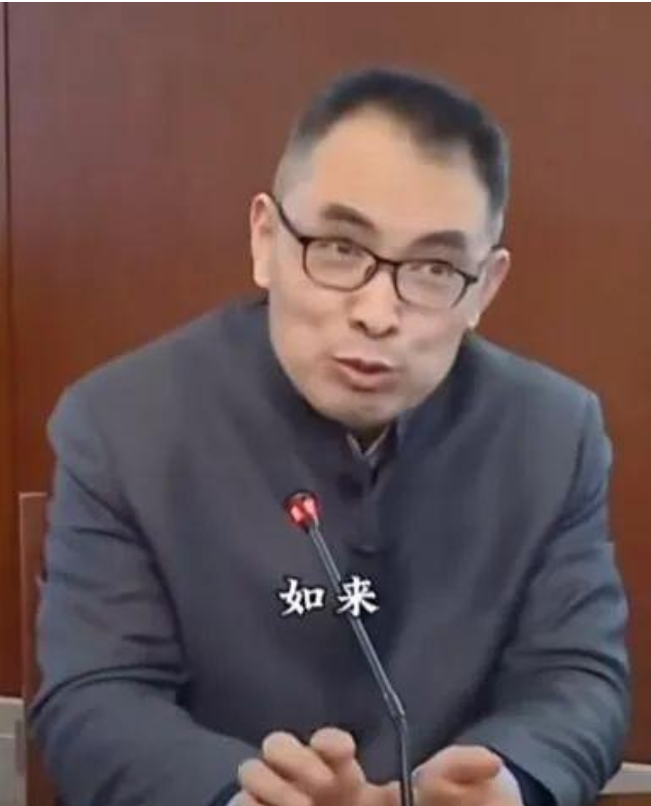

> 本篇文章不涉及贩卖焦虑与带货，也不涉及任何政治立场。所有观点仅为个人见解。

最近几年，随着AI的出现，总能听到一种说法——“技术已死...技术没那么重要了”。
仿佛时代一夜之间变了天，对于程序员与工程师们来讲曾经最硬的能力，突然失去了意义。

可如果真的冷静想一想，这句话本身就有问题。

###  “技术已死?" 真的死了吗？ 如死。

技术从来没有“活过”，又谈何“死去”？

各位好啊，今天咱们聊聊一个热议话题：AI来了之后，大家都在说“技术已死”。这话让我想起了某个技术大佬，他早期是搞嵌入式Linux的，教程干货满满，教了不少人卷技术路径。但最近他的言论越来越极端，从质疑技术价值，到全盘否定过去的努力，甚至传出要出家遁世的动态。这让我震撼，也引发了我的思考：技术真的死了吗？技术已死？真的死了吗？如死。

哈哈，这个“如死”是个梗，源自郭继承教授的抽象哲学表达——死了？没死？如死。意思是好像死了，又没完全死。技术也是这样，它死了一半，没死的一半还活得更旺盛。咱们别急着下结论，先来批判一下“一元价值论”——就是把一种东西当成人生或社会的唯一锚点、唯一准则。这种活法，看起来简单高效，但一遇到真实世界的复杂性，就容易焦虑爆棚、世界观崩塌。

比如，企业迷信“银弹理论”，以为一套ERP系统或CMS就能解决所有管理问题，结果忽略了团队协作、文化融合和市场变化，系统上线后一堆问题，效率反而下降。中国家长往往相信孩子到了年龄就必须恋爱、结婚、生子，把这当成唯一的人生脚本，却没考虑孩子的个性、时代变迁和社会压力，导致家庭矛盾频发。还有象牙塔里的学生，只把一种思想观奉为圭臬，比如极端理想主义或实用主义，出校门前高谈阔论，出校门后面对现实的灰色地带，就出现“神兔二相性”——表面一套、内心一套，认知撕裂，焦虑加剧。

为什么会这样？因为只用一种价值观或准则去看世界，就像戴着一副有色眼镜，忽略了生活的多维性和不确定性。真实世界不是黑白二元，总有灰度、冲突和意外。一旦锚点失效，焦虑是必然的，世界观崩塌也是必然的。然后，就会有一些人开始“否定之否定”——不是理性反思，而是全盘或部分否定以前的自己。关键是，他们还没否定对，还没真正搞清楚哪里错了、哪里还能保留，就急于求成，滑向另一个极端。比如，从“技术是万能信仰”直接摆到“技术全无意义、出家解脱”；从“唯物主义极端”到“唯心主义极端”；从“一切为了效率”到“一切为了躺平”。这种反弹，看起来很决绝、有勇气，但其实是另一种逃避——没耐心拆分问题、重建平衡，就直接推倒重来，结果往往从一个坑跳到另一个坑，循环往复。

好，那大家说的“技术已死”到底在说什么？咱们客观地把技术分成几个部分来看。

首先是决策部分：这包括价值观认同、社会接受度、短期长期效益，以及一些敏感问题的考量。比如，你要开发一个AI产品，得先问：这个功能符合社会伦理吗？用户隐私怎么保护？短期能赚钱，但长期会不会带来社会问题？这些不是代码能决定的，得靠人脑的综合判断。

其次是执行部分：我们很多人（包括我以前）把“技术价值”几乎全部压在“干活的过程”上——手敲代码、调参数、debug、写文档、优化性能、刷题、卷框架……这些曾经是“技术人”的核心身份符号、努力证明、薪水来源、自我认同。但现在，AI把这些过程基础设施化了，性价比碾压，过程确实死了。

最后是反馈部分：执行完了，得看结果反馈，然后调整。这部分AI也能帮忙，但真正值钱的还是人类的解读。比如，用户反馈数据来了，AI能统计数字，但你得判断“为什么用户流失？是功能bug，还是体验不人性化？”；A/B测试结果出来了，AI能算胜率，但你得权衡“短期转化高，但长期品牌损伤大不大？”；危机响应时，AI能生成方案，但你得评估“这个道歉文案会不会火上浇油？社会敏感度怎么把控？”这些反馈解读，靠的是人的经验、直觉和责任感。

从马克思主义哲学角度看，工具本身的价值是相对的。马克思在《资本论》里讲相对剩余价值：新技术工具（如AI）出现时，能提高生产率，短期内创造更多价值，所以相关技能（如AI工程师）工资高、需求旺。但当工具普及到一定程度，全社会生产力平均化了，相对剩余价值就减少，价格（包括工资）会降低。就像纺纱机发明时，纺织工工资一度高，但机器普及后，就成了普通劳动力。AI也一样，现在火爆，但等人人都会用，它就从“稀缺技能”变成“基础设施”，薪水会趋于平均。

更深入点，马克思主义的辩证法能帮我们更好理解这个过程。辩证法强调矛盾统一、对立斗争是发展的根本动力。比如，对立统一规律告诉我们，技术里有执行过程（量变）和决策判断（质变）的矛盾统一——AI加速了量变（过程效率），但推动质变（价值守护）的还是人的斗争和转化。质量互变规律提醒我们，AI普及是渐进的量变积累，到达临界点后，会引发行业质变（如岗位重组）。否定之否定规律则指出，技术从“过程主导”否定到“AI主导”，再到“人类主体回归”的更高阶段，是螺旋上升的进步，不是简单死亡。

不过，马哲本身也是工具——一种分析世界的框架，别过度迷信。马克思的理论强调辩证法、矛盾统一，不是教条。工具本身没有好坏，只有用的地方对不对。比如，朴素唯物主义思想，明白阴阳与五行，就能学懂一部分中医——阴阳对立统一，五行生克制化，这和辩证法相通，能指导养生调理。但如果过度迷信，把它当成唯一真理，忽略现代医学，就可能出问题。最终，还是要让工具回归工具，让人来灵活使用。AI是杠杆，马哲是镜子，技术是手段——人作为主体，去定义、判断、守护价值，才是王道。

技术死没死？如死。死了过程，没死主体。别让单一锚点绑架自己，世界多维，人生无限。谢谢观看，欢迎讨论！
