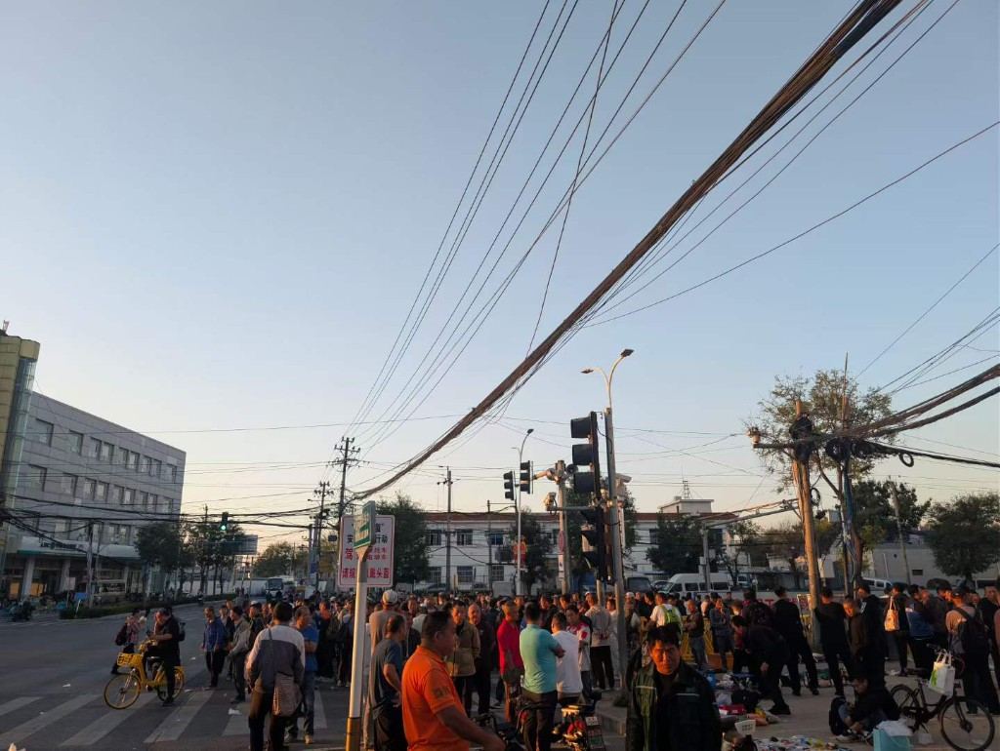
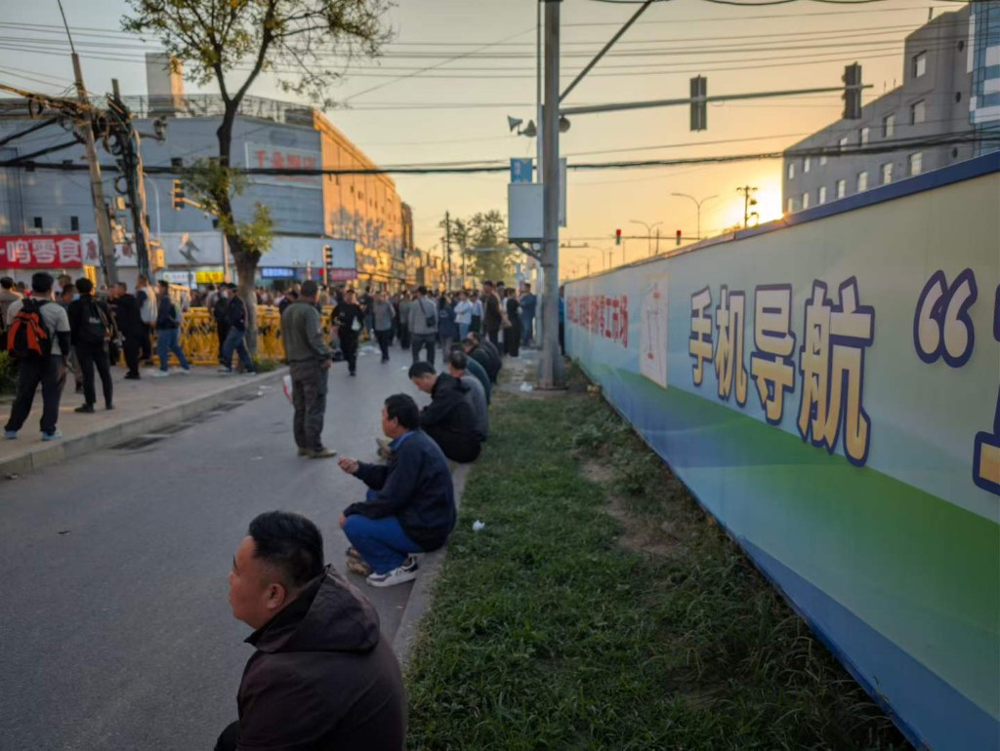
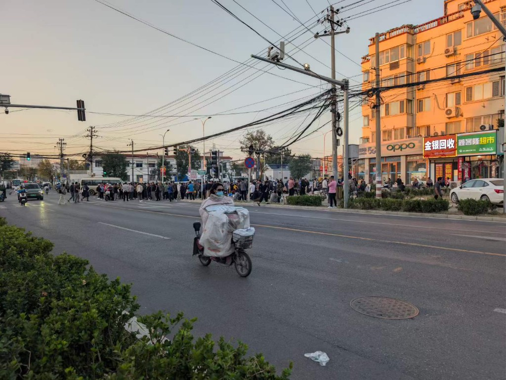

在经济下行周期中，宏观市场的高效运转，依赖于一个庞大且廉价的劳动力蓄水池。它不仅将人力的流转成本压缩到极致，更通过维持底层适度的匮乏与认知局限，确保了廉价劳动力的充分内卷。对市场而言，劳动力就像是K8s集群中被HPA动态调度的Pod——按需拉起，用完释放，人在其中只是按需调度的弹性耗材。如果说得再极端一些，甚至都不是Pod，只是一个函数：无需管理生命周期，无需占用本地资源。

<!-- truncate -->

写字楼里的“优化裁员”与马驹桥的“日结落空”，本质上没有高下之分，只是包裹的糖衣不同。今天被明码标价挑拣的他们，就是下一个下行周期里，随时可能坠落的我们。
