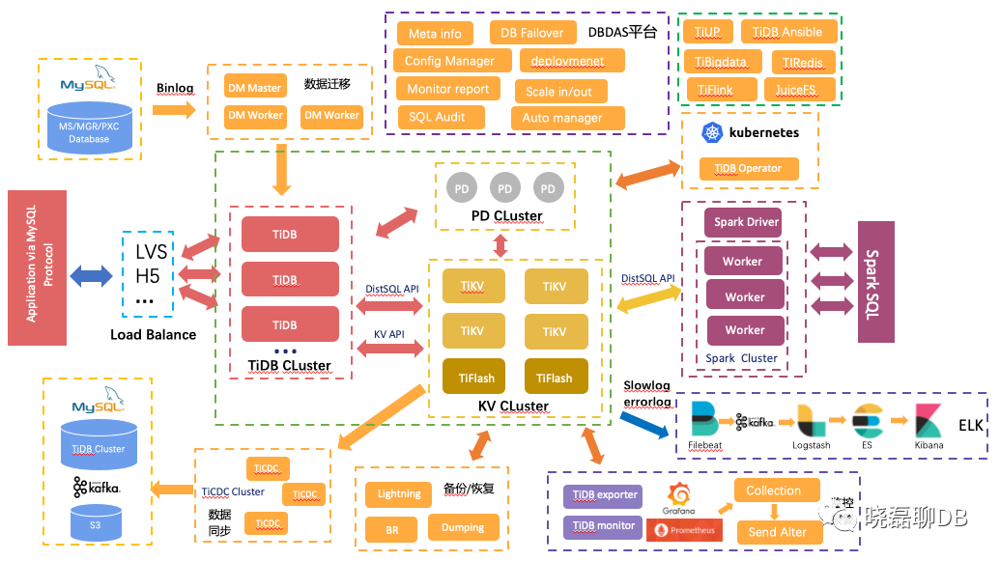
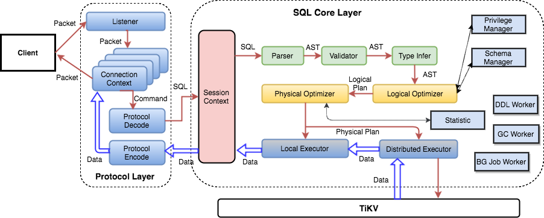

使用GO语言开发 
```
优点:
1. 纯分布式架构 拥友良好的拓展性 支持弹性拓展 
2. 兼容性好 MySQL语法 大多数场景可以替代MySQL
3. 默认支持高可用 少数副本丢失 数据库本身具有自动修复能力和故障转移 对业务透明
4. 支持ACID 强一致性
5. 生态丰富
```



1. 一个region 默认96M(96M第于千兆网卡的流量) startkey endkey 左闭右开
2. 三个组件
	1. `TiDB Cluster 计算节点`  
	2. `KV cluster存储节点 144m region切分`  
	3. `PD cluster 集群大脑 负责调度`
3. `DM数据同步工具`  模拟MySQL的slave节点做快照 +通过全量抽取binlog的方式同步数据,支持全量同步与增量同步
4. 安装组件:
	1. `Tiup`  一个强大的部署与运维工具 对3.0 4.0 兼容性支持不太好 新版本没问题 
	2. `TiDB Ansible`  也是统一部署 延迟  复杂
	3. `TiBigData` 大数据组件生态
	4. `TiRedis` Redis作为组件 类似于MySQL管理menchace引擎
	5. TiFlink
	6. `JuiceFS` 基于TiKV的分布式文件存储系统
5. 基于k8s部署TiDB --> TiDB Operator
6. Spark SQL 基于TiFlash集成更具备优势  基于TiKV的对系统侵入性太强(KV接收线上的读写业务 Spark SQL算子会将TiKV的负载拉到很高 影响正常业务)
7. 日志:  ELK 把TiDB的Error日志与Slow日志 filebeat-->kafka-->es-->kibana
8. 监控:  TiDB exporter + TiDB montor  --> promethues-->收集器-->告警
9. 备份工具:
	1. Lighting 备份恢复 导入 (可以将文本数据转化成KV数据灌入TiKV ,不经过SQL层速度快 )csv
	2. BR 专门做备份恢复region用的 物理备份
	3. Dumping 逻辑备份 

### TiDB组件介绍
```bash
key value -->table
每个表: tableid_rowid value-->映射成table表结构
```

```notion-like-tables
table-id-ktW2a3
```
**TiKV（OLTP，行存）+ TiFlush（OLAP，列存）**
* KV二级索引设置*
```
1. key:索引列信息+value:table主键--> 原表的key-value
```

* SQL引擎过程*
```
1. SQL语法,语义解析
2. ast抽象语法树
3. 逻辑优化
4. 物理优化:根据成本模型优化
- cpu io 等最佳执行计划
5. 分发到执行器 到Tikv执行
```
[介绍](https://blog.csdn.net/solihawk/article/details/118990546)

* 优化策略*
```
- tikv层做好本地预计算
- 上报tidb层进行计算聚合
	- 分发到每个kv
	- 每个kv层的协处理器进行本地预计算 上报给TiDBserver
	- 避免server 做过多计算 本地先jion 
```

*  online ddl*
```
1. 对业务无重大影响, 对表结构无影响(本质上是kv)
- 新增字段 默认是0 新数据按照新schema存储  老数据在变更和读取时才进行schema变更 大搞schema变更解耦
```

#### 如何构建一个Online DDL算法
```
* 第一 在TiDB里没有分表概念 ,所以整个DDL完成过程是非常快速的*
* 第二 把DDL的工程分成Public Delete-only Write-only等几个状态 每个状态在多节点之间同步和一致,最终完成完成的DDL。
```

#### TiDB-HTAP介绍
* 正常的ap计算(统计分析)框架*
```
TP: 高并发 低延时(在线业务)
AP: 吞吐量 数据切割与分析(列式存储 )
```

#### 分析流程
OLTP--> binlog-->MQ-->ETL(hadoop ods)-->OLAP(BI)

* HTAP*
```
- 分布式数据库同时满足TP和AP要求 ,模糊AP和TP的界限
	- 早起的TiDB定位解决大数据量级的OLTP系统
	- AP需要引入新的在组建模块
- 引入tispark 从tikv中搭建计算引擎
	- 低并发 重量级
- 引入tiflash
	- 列式存储对OLAP友好 选择列存引擎进行AP计算
	- 引入clickhouse底层存储引擎deleteMerge优化tiflash
	- 将tikv副本通过raft进行准实时的tiflash副本更新 tiflah副本仅同步不参与选举
```

* 引入MPP*
```
MPP: 并行计算 聚会结果 jion
- mpp 在tiflash节点将多表关联结果数据保持分布一致
- - worker 负责在多个节点计算上一步的分割表关联结果
- 结果给到tidb-server集合计算

```

#### 推行TiDB的关键点

```
根据时间与ID  -->id不连续 、存储过程的支持程度、 对外键 、变更  、细微差距

```

#### TiDB-server

逻辑优化与物理优化
执行层 范围 join 复杂查询用distSQL
键值对
tidb和pd做交互 获取meta信息与region与数据的位置申请tso时间戳
 执行DDL worker-->工作线程
从TiKV拉取出来的中间数据 统计信息  
```

TiDB Server 负责接收 SQL 请求，处理 SQL 相关的逻辑，并通过 PD 找到存储计算所需数据的 TiKV 地址，与 TiKV 交互获取数据，最终返回结果。TiDB Server 是无状态的，其本身并不存储数据，只负责计算，可以无限水平扩展，可以通过负载均衡组件（如LVS、HAProxy 或 F5）对外提供统一的接入地址。

# 各个模块基本功能
protocol+parse 处理客户端连接+SQL解析和释义
Execuote+DistSQL: 分批SQL执行计划下发kv
PD+TiKV : 进行比如时间戳的时间交互
DDL:load+worder+start job
memBuffer: 缓存元数据 登入信息等

```
1. 处理客户端的链接 协议层
	1. 鉴权 有效性
2. SQL语句的解析和编译
	1. ast 逻辑优化 物理
3. 关系型数据与kv转化
	1. SQL转kv 
4. SQL语句的执行
5. 在线DDL
6. GC
tikv client 与tikv交互
#### 启动与关闭顺序
```bash
启动顺序: PD -->TiKV -->TiDB --> TiFlash
关闭顺序: TiFlash -->TiDB -->TiKV -->PD
```
#### TiKV
```
TiKV Server 负责存储数据，从外部看 TiKV 是一个分布式的提供事务的 Key-Value 存储引擎。存储数据的基本单位是 Region，每个 Region 负责存储一个 Key Range（从 StartKey 到 EndKey 的左闭右开区间）的数据，每个 TiKV 节点会负责多个 Region。TiKV 使用 Raft 协议做复制，保持数据的一致性和容灾。副本以 Region 为单位进行管理，不同节点上的多个 Region 构成一个 Raft Group，互为副本。数据在多个 TiKV 之间的负载均衡由 PD 调度，这里也是以 Region 为单位进行调度。
```
1. 数据持久化
2. 分布式事务支持
3. 副本的强一致和高可用
4. MVCC
5. Coprocessor(算子下推)

#### PD
1. 整个集群的Tikv元数据存储
2. 分配全局ID和事务ID
3. 生成全局时间戳`TSO`
4. 收集集群信息进行调度
5. 提供TiDB Dashbord服务(集群信息 热力图 慢SQL 延迟 诊断)
```
Placement Driver (简称 PD) 是整个集群的管理模块，其主要工作有三个：一是存储集群的元信息（某个 Key 存储在哪个 TiKV 节点）；二是对 TiKV 集群进行调度和负载均衡（如数据的迁移、Raft group leader 的迁移等）；三是分配全局唯一且递增的事务 ID。

PD 通过 Raft 协议保证数据的安全性。Raft 的 leader server 负责处理所有操作，其余的 PD server 仅用于保证高可用。建议部署奇数个 PD 节点。
```
```bash
简介:
1.3个etcd-raft保证单点⾼可⽤,其中1个pd为leader
2.集群元信息存储管理,全局时钟管理,Region调度等
Store:⼀个服务器⽤来运⾏TiKV
Peer:每个副本叫⼀个Peer  (Leader Region + Follower Region = Peer )
multi raft:多个raft group组成 (3个Peer=1个raft group)
主要功能:
1.整体TiKV元数据信息存储
2.分配全局ID和事务ID
3.⽣产全局时间戳TSO
4.收集集群信息进⾏调度
5.提供label功能⽀撑⾼可⽤
6.提供TiDB Dashboard服务
```

* 运行一段时间之后 新扩容进来的TiKV ID数值比较大
#### **TiFlash**(列式存储 OLAP)
1. 列式存储提高分析查询效率
2. 支持强一致和实时性
3. 业务隔离(使用不同的服务器进行隔离)
4. 只能选择
TiKV 节点小于 3 万，Region 间隔 10 秒向 PD 汇报心跳信息（请求数量、状态、大小）
region 过大或者过热 进行切分与合并

#### GC
- MVCC 有历史版本数据(对同一行有多个历史版本数据)
- GC 负责定期处理过多的历史版本数据(每 10 分钟)
- TiDB Server 中有一个 GC leader 负责 GC 处理
#### 流程
1. TiDB Server 计算一个 safe point（比如 4 小时）
2. 时间戳内数据都保留，其余 GC 回收，称为 gc_life_time
```


#### 分布式事务
分布式事务 的锁
1. 所有事务开始的时候会向pd请求时间戳
2. 开始提交之后将数据default列簇写入大于`255kb`的数据预写入日志 
3. Lock列簇  防止别人对数据进行修改 对数据进行上锁 (写  主键)
4. Node2节点default列簇相同 
5. Lock列簇将自己节点的锁 指向了Node1的锁
6. Node1: 事务会把提交信息写入到Write 列族里面 进行写入持久化
7. Node1: 释放锁 不删除这条所锁信息  添加删除锁信息的操
8. Node2: 探测到锁释放 也添加删除锁信息  
#### TiKV基于Ratf算法的分布式⼀致性
```
raft leader 节点负责读写 一个集群只能有一个leader
follower接受不到leader⼼跳,变成cadnidate候选者,进⾏选举 (radom随机数1-200ms)

#region 本质也是左闭右开的区间 分裂数 144M

#Multi Raft
1.多个region group
2.⼀个tikv node不要超过5Wregion,(5.0以后)⼼跳汇报压⼒过⼤(开启静默region优化)
大规模集群即使空载也会产生很大压力  静默region的优化也被提出

对集群感知能力下降  如果是leader region 存在5分钟不可用时间
```
* TiCDC 是向下游的Kafka或者下游的MySQL同步数据的中间件  开启CDC之后会扫描所有leader region,即使用了静默region也是不生效的*
TiKV 分了两个rocksDB 一个存储binlog日志 一个存储数据

#### 持久化

```
0.PD获取TSO
1.TiDB Server接受写⼊数据,载⼊缓存
2.client commit后从进⾏两阶段提交
3.PD获取TSO
4.TiKV写⼊tikv的raftstore pool线程池，写请求转化成raft kv存储到rocksdb raft持久化raft log，然后传
输给其他node的 raftstore pool-->rocksdb raft
5.⼤多数节点返回传输成功,则认为修改成功,底层raft⽇志commit
6.raftstore pool独处raft log应⽤到apply pool,最终数据写⼊到rocksdb kv
7.事务commited正式提交,
#写⼊key=1 value=Tom
1.propose：转化为raft log
2.append:存储到raft log的kv
3.replicate：复制到其他node
- append:其他node持久化raft log影响成功
4.committed：⼤多数副本返回成功后,raft log进⾏commited,可以准备写⼊正式数据
5.apply：数据写⼊kv,⽤户的commttied),成功后其他client才能读到数据


假如rocksdb tikv挂调之后  在用户层感知是延迟增加
```

* lease Read
```ease read：10：00发送⼀个⼼跳,heartbeat time interval给回应,读取
local read：在election timeout抽期内时间内发⽣读取,肯定是leader.(10:00-->election)ease read：10：00发送⼀个⼼跳,heartbeat time interval给回应,读取
local read：在election timeout抽期内时间内发⽣读取,肯定是leader.(10:00-->election)
```


在一个选举超时时间之内 leader没有发生变化的


* Follower Reader  
```
1.10:00写⼊ 1,Tom-->Jack
2.1-95 raft log commit⼀致
3.10：05,⽤户发起read 读取当前 commitindex,等到97被应⽤,读取到1-97
4.10:08 ⽤户commit
5.follower：主:10:10 1-97被apply
5.⽤户10：10读取,1-97 commit,则1-95被读取到
10：05-10：10等待apply到97,如果follower apply应⽤⾮常快到 10:06到1_97
总结:follower read读取⽐leader快,数据可能更新,应为apply可能更快
 Follower Reader Region 可能会稍微慢一点(从节点向主节点发起RPC查询 如果变更就进行同步 )
```

#### 协处理器
* 帮助TiDB减轻计算压力
```bash
问题:⽹络带宽+cpu负载在tidb中运算 负载很重
Coprocessor功能:tikv帮助tidb减轻计算压⼒,下推到Coprocessor
1.tikv server收到 Coprocessor请求对算⼦进⾏计算,减轻tidb server压⼒
2.tidb server负责聚合结果即可
执⾏物理算⼦,计算中间结果 table scan，index scan，分析 统计 采样
```

#### TSO
```bash
TSO= physical time(ms) + logical time(1ms分成262144 TSO区分),int64
1.TSO请求给PD-Client
2.PD-client-->PD leader收到请求,返回异步对象 tsFuture-->TSO请求
3.PD分配TSO呆着 tsfuture-->TSO请求
```

```bash
TiDB⼤流量分配TSO问题？
1.PD批量给TiDB Server批量时间戳(未来3s),变成间隔批量请求,减轻压⼒
2.其他TiDB Server请求按照间隔时间段分配。
3.如果PD宕机,会接管已经分配最新TSO继续进⾏进⾏TSO分配
```
PD负载高 引起TSO的等待时间加长

#### 配置
```config
1.
mkdir -p tidb-deploy/tidb_test
tiup cluster template > topology.yaml
vim tidb_test.yaml
global: #全局设置
	user: "tidb" 
	ssh_port: 22
	#部署目录
	deploy_dir: "/chj/app/tidb/deploy" 
	#数据目录
	data_dir: "/chj/app/tidb/data"
	arch: "amd64" 
monitored:
    #服务器指标监控
	node_exporter_port: 9100
	#TiDB组件监控
	blackbox_exporter_port: 9115
	deploy_dir: "/chj/app/tidb/monitored/monitored-9100"
	data_dir: "/chj/app/tidb/monitored/monitored-9100/data"
	log_dir: "/chj/app/tidb/monitored/monitored-9100/log"
server_configs:
	tidb:
		#开启切分table
		split-table: true
		#内存最大quota
		mem-quota-query: 2147483648
		# 是否弃用oom storage 如果oom是log到20G的临界值后端不会强杀SQL,如果是40G 20G放内存20G放文件中做查询 如果/tmp目录是20G需要注意
		oom-use-tmp-storage: true
		tmp-storage-quota: 2147483648
		oom-action: "log"
		#连接池最大连接数
		max-server-connections: 2000
		#最大索引值
		max-index-length: 6144
		#表最大列数
		table-column-count-limit: 4096
		#最大索引个数
		index-limit: 64
		#日志格式 
		log.level: "info"
		log.format: "text"
		log.enable-slow-log: true
		log.slow-threshold: 3000
		log.record-plan-in-slow-log: 1
		#继承expensiveSQL值
		log.expensive-threshold: 1000000
		#查询最大长度
		log.query-log-max-len: 40960000
		#日至保留时间
		log.file.max-days: 30
		#是否开启binlog
		binlog.enable: false
		binlog.ignore-error: false
		performance.max-procs: 32
		#TiDB-server最大内存查询大小
		performance.server-memory-quota: 128849018880
		#使用内存百分比告警
		performance.memory-usage-alarm-ratio: 0.8
		#事务的size 设置了6M(后续查询一下)
		performance.txn-entry-size-limit: 6291456
		performance.txn-total-size-limit: 209715200
		performance.cross-join: false
		performance.pseudo-estimate-ratio: 0.5
		status.record-db-qps: true
		stmt-summary.max-stmt-count: 200000
		stmt-summary.max-sql-length: 409600
		pessimistic-txn.max-retry-count: 64
		pessimistic-txn.deadlock-history-capacity: 10000
		experimental.allow-expression-index: true
tikv:
	raftdb.defaultcf.force-consistency-checks: false
	raftstore.apply-max-batch-size: 256
	#apply经常阻塞或者变慢需要调整这个值
	raftstore.apply-pool-size: 10
	raftstore.hibernate-regions: true
	raftstore.messages-per-tick: 1024
	raftstore.perf-level: 5
	raftstore.raft-max-inflight-msgs: 2048
	raftstore.store-max-batch-size: 256
	#写日志线程池 replace模块交互
	raftstore.store-pool-size: 8
	#(redo日志是否要落地 和MySQL是否开启双1一样)不建议是false 无论是否配置 4.0之后强制为true
	raftstore.sync-log: false
	readpool.coprocessor.use-unified-pool: true
	readpool.storage.use-unified-pool: true
	readpool.unified.max-thread-count: 12
	rocksdb.defaultcf.force-consistency-checks: false
	rocksdb.lockcf.force-consistency-checks: false
	rocksdb.raftcf.force-consistency-checks: false
	rocksdb.writecf.force-consistency-checks: false
	
	server.grpc-concurrency: 8
	#TiKV缓冲区缓存了region的最近最热数据大小设置成最大内存的60%
	storage.block-cache.capacity: 32G
	storage.scheduler-worker-pool-size: 8
pd:
	schedule.leader-schedule-limit: 4
	schedule.region-schedule-limit: 1024
	schedule.replica-schedule-limit: 8
tiflash:
	path_realtime_mode: false
	logger.level: "info"
tiflash-learner:
	log-level: "info"
	raftstore.apply-pool-size: 4
	raftstore.store-pool-size: 4
pd_servers:
	- host: 172.21.64.7
		ssh_port: 22
		name: "pd-55"
		client_port: 2379
		peer_port: 2380
		deploy_dir: "/chj/app/tidb/deploy/pd-2379"
		data_dir: "/chj/app/tidb/data/pd-2379"
		log_dir: "/chj/app/tidb/deploy/pd-2379/log"
	- host: 172.21.64.8
		ssh_port: 22
		name: "pd-56"
		client_port: 2379
		peer_port: 2380
		deploy_dir: "/chj/app/tidb/deploy/pd-2379"
		data_dir: "/chj/app/tidb/data/pd-2379"
		log_dir: "/chj/app/tidb/deploy/pd-2379/log"
	- host: 172.21.64.9
		ssh_port: 22
		name: "pd-57"
		client_port: 2379
		peer_port: 2380
		deploy_dir: "/chj/app/tidb/deploy/pd-2379"
		data_dir: "/chj/app/tidb/data/pd-2379"
		log_dir: "/chj/app/tidb/deploy/pd-2379/log"
tidb_servers:
	- host: 172.21.64.7
		ssh_port: 22
		port: 4000
		status_port: 10080
		deploy_dir: "/chj/app/tidb/deploy/tidb-4000"
		log_dir: "/chj/app/tidb/deploy/tidb-4000/log"
		config:
			log.level: info
			log.slow-query-file: tidb_slow_query.log
	- host: 172.21.64.8
		ssh_port: 22
		port: 4000
		status_port: 10080
		deploy_dir: "/chj/app/tidb/deploy/tidb-4000"
		log_dir: "/chj/app/tidb/deploy/tidb-4000/log"
		config:
			log.level: info
			log.slow-query-file: tidb_slow_query.log
- host: 172.21.64.9
	ssh_port: 22
	port: 4000
	status_port: 10080
	deploy_dir: "/chj/app/tidb/deploy/tidb-4000"
	log_dir: "/chj/app/tidb/deploy/tidb-4000/log"
	config:
		log.level: info
		log.slow-query-file: tidb_slow_query.log
tikv_servers:
	- host: 172.21.64.10
		ssh_port: 22
		port: 20160
		status_port: 20180
		deploy_dir: "/chj/app/tidb/deploy/tikv-20160"
		data_dir: "/chj/app/tidb/data/tikv-20160"
		log_dir: "/chj/app/tidb/deploy/tikv-20160/log"
	- host: 172.21.64.24
		ssh_port: 22
		port: 20160
		status_port: 20180
		deploy_dir: "/chj/app/tidb/deploy/tikv-20160"
		data_dir: "/chj/app/tidb/data/tikv-20160"
		log_dir: "/chj/app/tidb/deploy/tikv-20160/log"
	- host: 172.21.64.25
		ssh_port: 22
		port: 20160
		status_port: 20180
		deploy_dir: "/chj/app/tidb/deploy/tikv-20160"
		data_dir: "/chj/app/tidb/data/tikv-20160"
		log_dir: "/chj/app/tidb/deploy/tikv-20160/log"
tiflash_servers:
	- host: 172.21.64.23
		ssh_port: 22
		tcp_port: 9000
		http_port: 8123
		flash_service_port: 3930
		flash_proxy_port: 20170
		flash_proxy_status_port: 20292
		metrics_port: 8234
		deploy_dir: "/chj/app/tidb/deploy/tiflash-9000"
		data_dir: "/chj/app/data/tiflash-9000"
		log_dir: "/chj/app/tidb/deploy/tiflash-9000/log"
	- host: 172.21.64.26	
		ssh_port: 22
		tcp_port: 9000
		http_port: 8123
		flash_service_port: 3930
		flash_proxy_port: 20170
		flash_proxy_status_port: 20292
		metrics_port: 8234
		deploy_dir: "/chj/app/tidb/deploy/tiflash-9000"
		data_dir: "/chj/app/data/tiflash-9000"
		log_dir: "/chj/app/tidb/deploy/tiflash-9000/log"
monitoring_servers:
	- host: 172.21.64.7
	ssh_port: 22
	port: 9090
	deploy_dir: "/chj/app/tidb/deploy/prometheus-8249"
	data_dir: "/chj/app/tidb/data/prometheus-8249"
	log_dir: "/chj/app/tidb/deploy/prometheus-8249/log"
grafana_servers:
	- host: 172.21.64.7
		port: 3000
		deploy_dir: /chj/app/tidb/deploy/grafana-3000
alertmanager_servers:
	- host: 172.21.64.7
		ssh_port: 22
		web_port: 9093
		cluster_port: 9094
		deploy_dir: "/chj/app/tidb/deploy/alertmanager-9093"
		data_dir: "/chj/app/tidb/data/alertmanager-9093"
		log_dir: "/chj/app/tidb/deploy/alertmanager-9093/log"
```
#### 连接
 tibd的root用户默认是没有密码的
 ```bash
1.tidb server⽆状态+⽀持mysql协议(5.7)
2.⽤户增加并发可以增加tidb节点扩缩容(每个节点⼤约能⽀撑tp业务-2000~3000 qps)
3.⽀持⼤部分Msyql5.7语法,不⽀持
- 外键
- 存储过程
- 触发器
- 多个ddl组合在⼀起
- 更多语法兼容性 https://docs.pingcap.com/zh/tidb/stable/sql-statement-add-column
4.API⽀持
Mysql⽀持的都⽀持,⽐如
5.使⽤限制
https://docs.pingcap.com/zh/tidb/stable/tidb-limitations
```

* 系统配置+集群配置
```bash
1.系统配置:持久化在tikv中
- ⼀部分在tikv中
- 有些专指tidb-server参数
- 不需要重启可持久化(set global xx = '';)
- 有作⽤域: global session instance(实例级别)
- **TiDB数据库的系统参数如何修改，是否有作用域？**

**答：**TiDB数据库的系统参数持久化在TiKV存储中，分为全局、会话和 Instance 作用域，set global 将全局作用域的系统参数修改后只会影响新建立的连接，不会影响当前的执行修改命令的连接和其他已有的连接；alter session只能修改当前会话参数，不会影响其他连接和新连接参数。
- set @@global.tidb_distsql_scan_concurrency = 10
- set global tidb_distsql_scan_concurrency = 10
2.集群配置:修改后需要reload 重启节点
- 都在配置⽂件中
- 修改后必须重启节点 tiup edit-config and tiup reload
```
* 数据⽂件
```bash
- 配置⽂件 .tiup/conf目录
- ⽇志⽂件 
- 脚本命令⽂件 bin
- 数据⽂件
```


##### 配置远程连接的用户密码

```bash
create user 'gaoxu'@'%' IDENTIFIED BY '123456';
GRANT all privileges ON *.* TO 'gaoxu'@'%' with grant option ;
FLUSH PRIVILEGES;

-- 检查用户权限
SHOW GRANTS FOR 'gaoxu'@'%';
```


#### 启动命令
```bash
tiup playground --db 2 --pd 3 --kv 3 --host 0.0.0.0
```


#### 备注
tidb数据库使用playground的方式只是临时的,重启之后数据会被销毁,如果想持久化数据 必须要生成配置文件 并且为集群命名 打tag的方式在v6版本中也已经废弃
