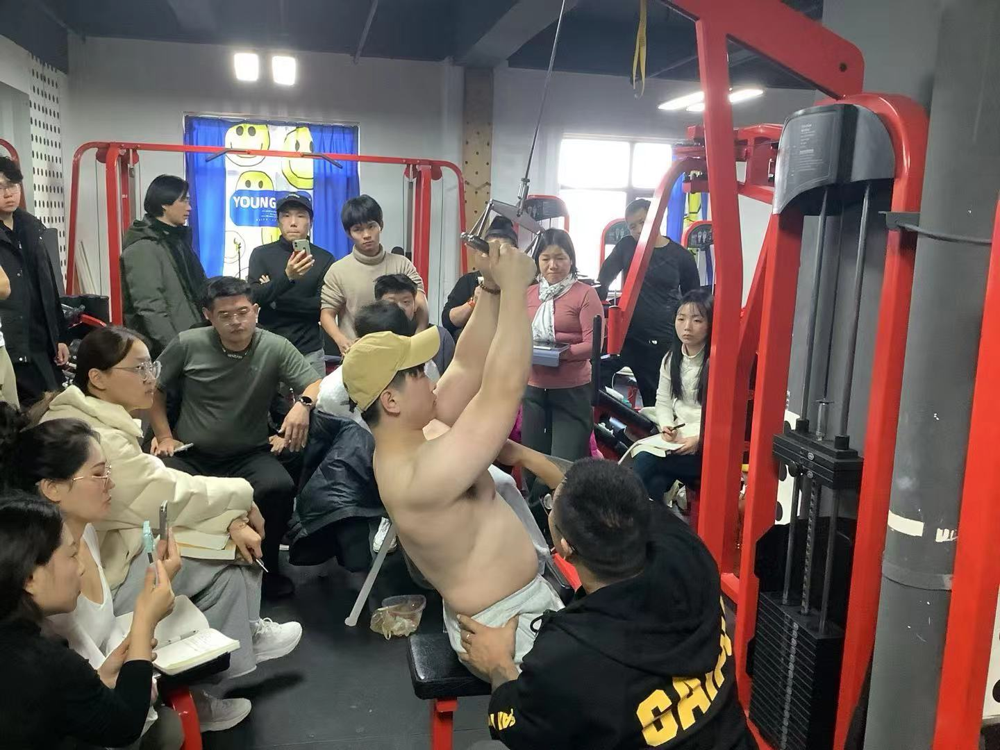
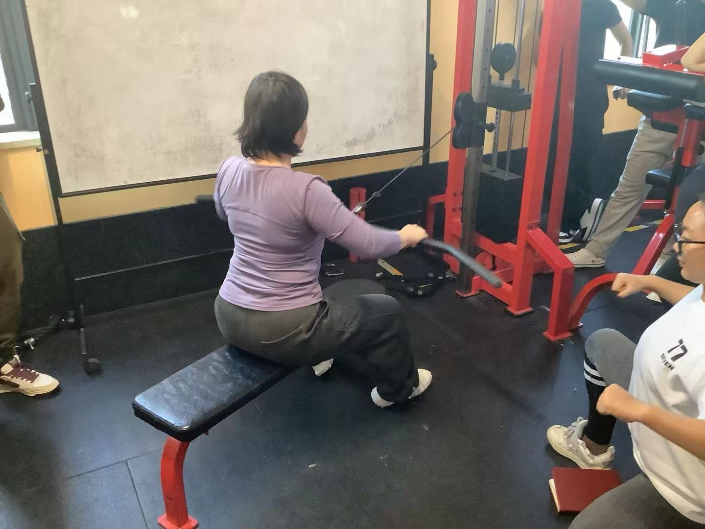

### 背部训练：
在形态上没有性别差异。
#### 背部形态分析：
整个背部以中线为主，犹如鬼脸。

#### 川字纹对应肌肉：
部位：中上斜方。
男性： 根据背部整体结构选择增强训练
#### 鼻梁：
部位：中下斜方、菱形肌 。
体态：影响中上背后都偏内侧。
训练模式：**开肘挺胸类划船，及宽距挺胸下拉类为主**。调整含胸、圆肩类体态。

#### 眼球：
部位：岗下肌、小圆肌
训练模式：以变角度下来类及肩关节伸位或者水平外展位外旋对抗为主。

#### 眼眶：
部位：大圆肌及上段背阔肌 影响背部整体宽度，
训练模式：以**降肋含胸位划船和宽距下拉类为主**

#### 脸：
部位：背阔肌 
体态：影响背部整体宽度和厚度。
训练模式：以闭肘挺胸类划船 及窄距反握下拉类为主

#### 下巴：
部位： 竖棘肌 
体态： 影响下被与上臀比例 
训练模式：以脊柱伸位对抗为主
#### 眉角：
部位：三角肌中后束
体态： 下背部脂肪堆积过多，高油 高盐 高油酸影响 
背部要宽且厚

#### 体态分析
先看整体 再看局部 再看弱项

### 整体宽度
#### 高位下拉：三种变式
1. 直背 后移15度 宽距
2. 立背 挺胸 宽距拉 中板后移30度 全握
3. 反握肩宽 直背下拉或对握窄距直背下拉
#### v把窄距高位下拉
训练侧重： 调整中下背厚度，背部宽度 放在背部训练中后段

注意： 胸椎伸展，避免过多下背部参与，骨盆微微前倾，上段调角度，下段固定，动上段
1. 握手把后部 闭肘 手肘靠近身体
2. 中板微偏前  肩带肘 肘找腰 下弧线运动
直背 v把 后移30度 沉肩下压 落点在下胸上

### 侧重背部整体厚度：
#### 俯身杠铃划船
部位： 中背部偏上厚度
利用矢状面肩主导，肩伸对抗
动作类型： 闭肘挺胸类 
全程保持肩伸锁定，杠铃贴腿
挺胸立背 头颈胸保持一条直线
强度：12-15rm 保持稳定 多磨技术

#### 体态问题
1. 髋屈俯身受限 ：下背部弓起，（髋伸肌群紧张，且髋关节灵活度不足）
2. 惯性屈膝 重心习惯向后 （腘绳肌群及小腿紧张，髋关节及踝关节相对灵活度不足）
3. 硬拉类角度过低 下背弓起
4. 深蹲类骨盆眨眼
如何调整？
拉伸腘绳肌，臀大肌

#### 罗马椅山羊挺身

部位： 下背部竖脊肌厚度，腰椎病变人群禁用
脚距与肩同宽
支撑性动作尽量放在训练后段

#### 俯身单臂哑铃划船
动作类型：单边调整类动作
1. 大腿垂直凳面，不下坐 
2. 调整骨盆平行地面， 个子高的可以使用上斜板 
3. 小臂始终垂直地面，大臂夹紧身体
#### 坐姿绳索划船 （龙门架绳索平替）
部位： 中上背厚度 
动作类型： 肩胛主导，开肘30-45°挺胸划船
1. 保持顶峰收缩，对抗慢离心 （宽握1.2 对握1.2）
2. 膝开角度120°。人前倾30°

### 背部功能性调整
#### 训练调整 
从上向下，从外向内
1. 高位下来做首个动作
2. 杠铃划船 （不好控制的往前排，12-15rm 减脂期自调）
3. 单臂哑铃 坐姿绳索划船更好上强度
4. 最后衔接绳索
#### 练一休一 
>练4次背，每次要有不同侧重点。

双关节类动作1分半 腿 背 2分钟 
单关节1分钟内

##### PRE 自我疲劳感受评估

| 级别  | 动作             |
| --- | -------------- |
| 6   | 无减速，无卡顿，还有3次余力 |
| 7   | 有减速 无卡顿 余力2    |
| 8   | 有减速 有卡顿 余力1-2  |
| 9   | 有减速 有卡顿 余力1    |
| 10  | 完全力竭           |
