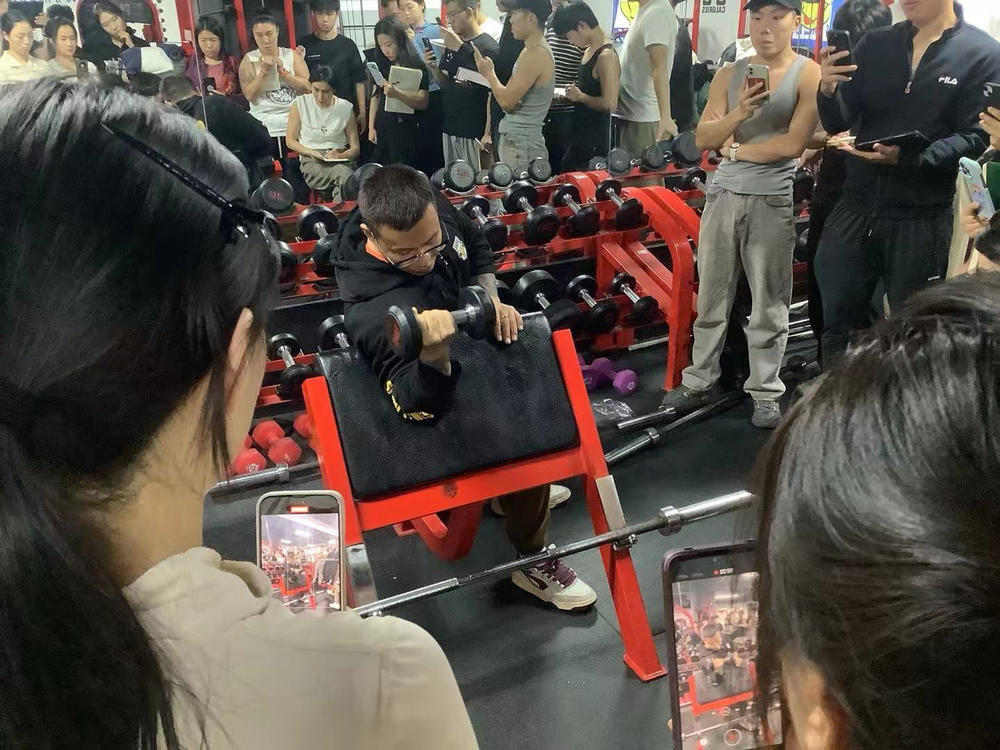
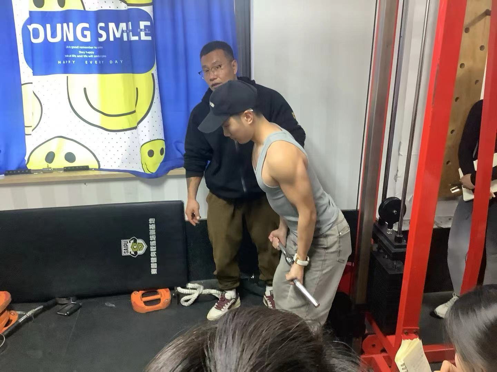

### 解剖
#### 上臂前侧： 肱二头肌
特点： 内侧长 外侧短
短头起点：肩胛骨喙突
长头起点： 盂上结节
止点： 桡骨粗隆于前臂筋膜
功能： 
1. 肘屈（主导二头整体维度）
2. 肩关节屈 复合动作： 肘屈+肩屈
	1. 在肘屈+主动肩屈模式下 发展整体，调整上段
	2. 肘屈+被动肩屈 低角度整体偏下 ，高角度整体偏上 
	3. 外旋 前臂上桡尺关节外旋
#### 上臂后侧： 肱三头肌
1.长头（上臂后内 双关节肌）
起点： 肩胛骨盂下结节 
2.外侧头: 肱骨体后桡神经沟外上方
影响上臂正面观视觉宽度。
3.内侧头： 肱骨体后桡神经沟内下方
止点： 尺骨鹰嘴
功能：长头使肩关节伸

### 训练计划
男性： 提高整体维度，建立上肢段肩臂比例
女性： 提高上肢基础力量，提高手臂线条感。

### 整体维度：
#### 杠铃弯举：
握距肩宽 肘屈主导，肩肘同线，垂直地面，重心下沉， 底端杠铃与大腿不触碰（肩胛后线）
小臂向上靠大臂，手腕固定

#### 牧师凳托臂弯举

**训练目的**：发展整体维度偏远端
立背挺胸，肩不前伸，肘窝朝前，只外旋 握距肩宽，对短二头有优势
强度：10-15rm  
#### 佐特曼弯举
```bash
通过网盘分享的文件：佐特曼托臂弯举-握头.mp4
链接: https://pan.baidu.com/s/1XD5Xt4NdUOrSvsPo0f9I8w?pwd=trj3 提取码: trj3 
--来自百度网盘超级会员v8的分享
```
哑铃抓头，上到平行位，外旋
下落到平行位，内旋
### 龙门架低位 W把绳索弯举
w把对手臂压力不高
#### 蹲姿托臂
**训练目的**： 发展整体偏上段
卡肘三头到膝关节 重心后压 手腕固定 全程保持肘窝向上

#### 仰卧位 高次数递减
无热身组可以递增 有热身组可以递期减 重量不变
6rm为最后一组重量 
肘不离地 ，整体练习全段肌肉 手短可以垫一块瑜伽砖
#### 站姿体后：

```bash
通过网盘分享的文件：站姿体后臂屈伸-三头.mp4
链接: https://pan.baidu.com/s/1JU7LJTn6xf1rwGYramH91w?pwd=bmqv 提取码: bmqv 
--来自百度网盘超级会员v8的分享
```
**训练目的**： 发展整体偏上段
	躯干前倾30度左右，肩肘腕垂直地面 眼睛看脚3wq1` 肩屈对抗锁定
#### 站姿体前（托把位 顶肘）：
```bash
通过网盘分享的文件：站姿体前托把位顶肘-外侧长头.mp4
链接: https://pan.baidu.com/s/1Pb0wzkADMW-7ZSEIzS2fog?pwd=u5jv 提取码: u5jv 
--来自百度网盘超级会员v8的分享
```
**训练目的**： 发展整体调外侧（长头）
把位贴胸，重心前倾，把把端起来的感觉

### 肱三头肌：
#### 龙门架曲臂下压
**训练目的**：发展整体维度
滑轮略高于头，面向滑轮 屈髋附身 30-45° 大臂靠近身体 肩肘同线，与地面垂直，掌根压把，放到腕肘同线，小臂平行地面

#### 俯卧杠铃臂屈伸
**训练目的**：发展整体维度，侧重长头厚度
肩屈稳定 肘伸对抗，（肌肉牵张反射） 不扣腕，不开肘


#### 俯身单臂哑铃臂屈伸
**训练目的**：发展整体维度 调整线条感 
哑铃肩肘同线，向后伸手臂。


