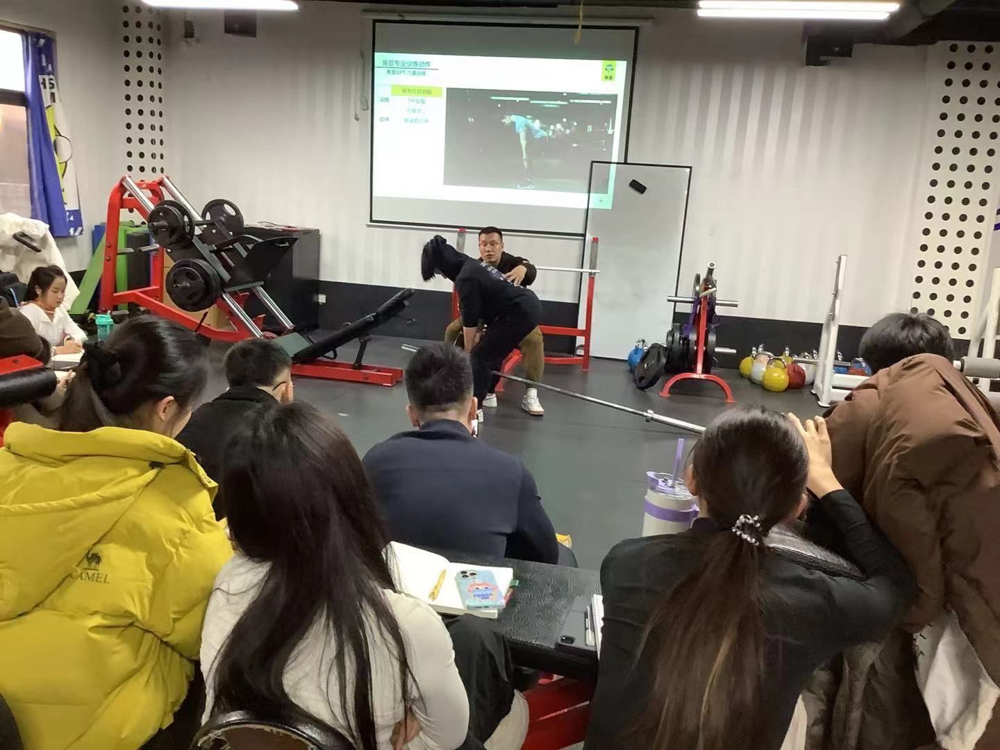

### 解剖
斜方肌：
	中上斜方
	中下斜方
#### 中上斜方肌：
肩胛骨上提 上回旋类为主
体态： 影响肩胛骨正位稳定，影响推举类 肩胛稳定支撑类稳定
从形态上看 构建上背部视觉厚度：
- **男性**：根据整体肩背状态进行增强训练
- **女性**：根据功能结构体态调整进行训练
#### 站姿杠铃耸肩
1.2倍杠  15-20次 激活肩胛上回旋 上抬伸肩 先放松肌肉 再调整关节 溜肩 肩胛过度向下（胸椎伸展，肩胛后缩外旋
可以作为肩背训练的前置动作 一般用自由杠
#### **一、 体前：**
**训练目的**：侧重上斜方厚度
#### **一、 体后：**
**训练目的**：侧重三角肌后束与上斜方连接厚度，可以放在肩部训练前，瘦子肩部有形态之后再训练斜方
训练强度： 4组 12-14个
肩胛骨找耳朵，杠位置在髋关节，脚背在杠下，不后仰，微微前倾，禁止爆发发力，慢离心。

#### 中下斜方肌：
以肩胛下降 后缩 下回旋（菱形肌）为主。
影响体态： 调整含胸，圆肩 肩胛骨前引，影响中上背内侧视觉厚度，提高卧推离心稳定性

#### 俯身直臂杠铃提拉：
卧推 肩胛压不住 顶峰锁不稳
拳面朝下，握距1.2-1.5倍 直背， 附身于地面平行 半手扣杠 肩胛骨下沉 男生可以挂片， 顶峰稳定 慢离心 刺激深层肌肉
### 引体类
#### 直臂高拉
手不发力，只动肩胛

#### 直臂引体
**训练目的**：背部宽度调整
#### 引体向上
**训练目的**： 引体悬挂辅助带 3个模式
##### 正握宽距挺胸位
**训练目的**：发展宽度，调整中上背厚度 背部身体类似C 肘部前收，拿自己的上胸找肘，握距1.5倍肩宽，挺胸前收肘，手臂微微外旋，上胸找把杆，全程保持胸椎伸展，视线向上。
##### 反握肩宽引体
**训练目的**：侧重提升背阔肌外沿厚度，肘找腰，收肘画后弧线。
可以用弹力带辅助，慢下落
##### 对握窄距挺胸位：
**训练目的**：中下背阔厚度内调 肘找腰，挺胸后仰，手握把根，肘不先动，和附身单臂哑铃划船的动作模式类似。

### 背部厚度训练 （划船类）
#### 附身杠铃划船
**训练目的**：侧重中背偏上厚度，肩关节主导，肩伸对抗，肩内收，及肩胛下沉协同稳定。
握距可以调
#### 动作二 低位杠铃划船：
**训练目的**：中上背阔厚度偏内侧 
肩宽1.2倍，与地面平行，二排指节朝下，在胸正下方。大臂30-45°夹角。
注意: 下背部病变，功能受限人群，不适合练习。
#### 海豹划船
有辅助稳定板的叫海豹式。中段偏后训练。 下胸位，二排指节朝下 孤立训练中上背，无器械可以使用牛角把，平替低位杠铃划船

#### 反握杠铃划船
与肩同宽，身体平行位，推到前脚掌足中位置。二排指节朝下，肩外旋。
闭肘挺胸划船类，后上提拉至小腹，中心压在足中偏前
#### 杠铃V把抱拉
**训练目的**：中背部 背阔肌上段
手握把头，脚对准片切线位置，中心压在脚跟，身体与地面45°夹角。
男生多做，收肘可以高于背，保持收紧，调整髋骨位置，重心向心。肩宽1.2 脚尖向两侧开45°

### 哑铃类
#### 附身单臂哑铃划船
**训练目的**：单边上背阔肌厚度。
肩关节主导，肩伸对抗。
#### 上斜俯卧双臂哑铃划船：
上斜俯卧45°初始肩宽，掌心相对，挺胸闭肘，朝后上提拉。
**训练目的**：侧重中下背厚度偏内侧，剑突位置卡板，下沉肩胛骨。手臂后上提找腰。目视前下方，方便伸直胸椎，哑铃握头露屁股。
八字对握也行（手肘微微内旋），肩胛后缩主导，大臂和躯干保持30°夹角，外弧线上提。
**训练目的**：侧重中上背厚度偏内侧