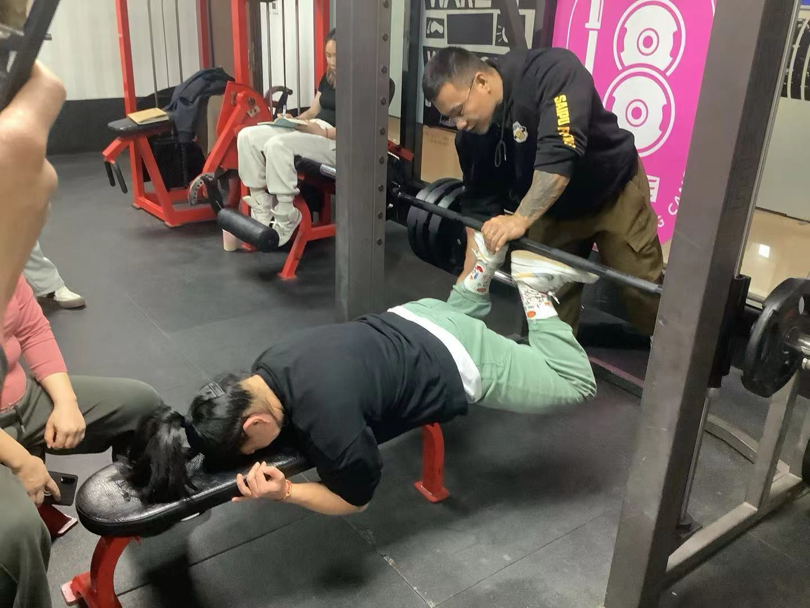
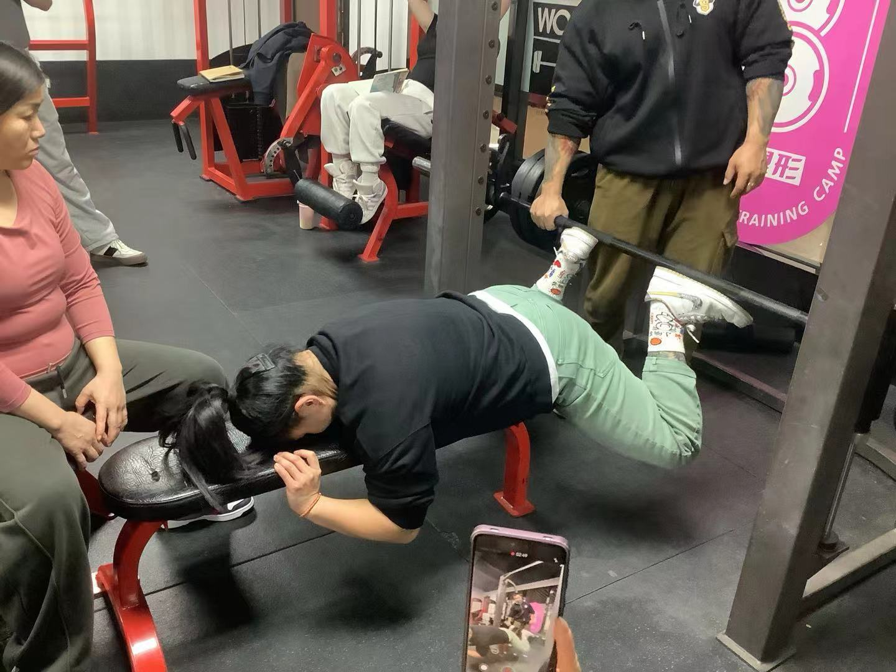

### 上臀：
1. 协同调整臀下垂
2. 提高臀部侧面观整体饱满度
3. 调整下背与上臀比例
### 中臀
影响局部整体维度
### 下臀
1. 辅助调整臀下垂 提高臀部上抛弧度

### 训练模式
#### 1. 硬拉类
##### 罗马尼亚硬拉（以及变式）绳索 杠铃 哑铃 机器
#### 2. 反向髋伸类
##### 史密斯俯卧后提腿 、绳索后提腿、罗马椅挺身
#### 中臀
##### 推类 
以推类 蹲类为主 （宽距蹲类） 杠铃臀桥（臀桥机优先）
##### 蹲类
史密斯宽距深蹲 反向哈克深蹲
#### 下臀（拉类、宽距类、变角度蹲类）

#### 反向髋伸类 
腹股沟卡板凳 头埋进板子里 手反握板 膝90°
俯卧后提腿（单腿 双腿）
蝎式后提腿---> 核心力量加强 吸气下落 髋微微外旋 
变式： 双膝外旋 上抬过程中脚跟碰在一起 小负重 曲杠放膝窝里 300-400次 后链练习

**训练目的**：上臀整体偏外
↑ 可以略高于大腿平行面，双膝面向两侧顶开， 并脚八字 

肩宽八字位 开脚 
**训练目的**：上臀整体偏内
进杠要求： 大腿与地面平行 小腿与地面垂直 腿长可以用腹肌板 
训练强度： 12-20rm 慢离心 顶端停顿

#### 罗马椅挺身
1. 脚尖外旋八字位 膝窝外旋 膝盖微屈 骨盆微微前倾 撅点屁股下沉，略低于骨盆 呼气含胸 。男生适合训练收尾。
### 下臀
#### 保加利亚深蹲
1. 坐板凳上，定脚距，重心压在前侧腿脚跟外脚掌上，同侧手扶住臀，身体前倾约30°。髋摆正，髋主导，膝协同 两脚肩宽站位。后侧腿上凳子，脚尖轻点凳板。往后下推，感受臀与大腿的牵拉感。膝盖放松不锁死。膝盖与脚尖方向一致。
### 腘绳
#### 坐姿腿弯举
膝屈主导，发展整体维度，调整远端，外八位练股二头肌，注意不要勾脚。 不撅屁股，臀不离板子，身体不前倾 平行位： 整体一半一半
女生注重后侧链 放到拉蹲后训练
全程保持顶峰收缩慢离心 腘绳肌属于慢缩肌， 不吃爆发
#### 倒蹬机
最大化提升膝伸能力 
1.中板肩宽位
**训练目的**：下肢大腿前侧，整体维度
放到训练中段偏后 双脚与肩平行，髋同线。大腿过垂直线
2.中板宽小八字位15°：
**训练目的**：侧重大腿前侧偏内，及大腿内侧肌群，
重量可以换成中板肩宽位一半 训练思路：整体强度优化，弱项逐渐增强。
3.中板偏上，高八宽距：
**训练目的**：侧重臀下角及腘绳

小腿方向： 慢离心 
膝微屈，位置有点靠下 ，提踵 1组40-50个 先慢慢加再到力竭
### 小腿 浅层 后侧 腓肠肌与比目鱼肌
功能： 协同膝屈 足跖屈
#### 站姿提踵：
训练腓肠肌
#### 坐姿提踵
适合女性 侧重比目鱼肌 男生顶峰收缩3s
#### 蹲姿提踵
