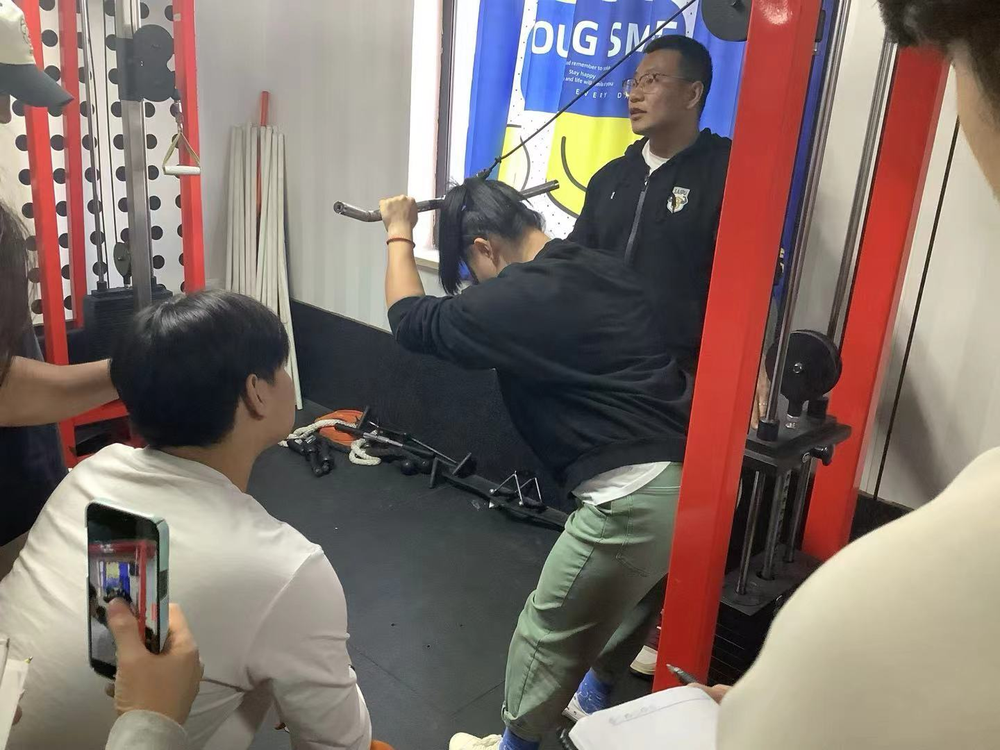

### 解剖
#### 肱二头肌长头：
起自肩胛骨盂上结节
短头： 起自肩胛骨喙突 
止点: 桡骨粗隆 前臂筋膜
功能： 肩屈 肘屈 前臂外旋
#### 肱三头肌长头：
起自肩胛骨盂下结节
内侧头： 肱骨体后桡神经沟内下方
外侧头： 肱骨体后桡神经沟外上方
止点： 尺骨鹰嘴
功能： 肩伸 肘伸

#### 训练关键点
1. 整体维度
2. 长头厚度  ----> 俯卧杠铃臂屈伸
3. 内外侧形态 
### 整体维度
#### 龙门架屈臂下压
#### 窄距卧推
强度区间： 8-20rm
手距肩宽，或略窄于肩
下落至大臂与店面接近平行，下落2-4指高度，落到下胸线为止，可以拉高三头代谢压力。
曲杆对手臂压力小，腕关节结构损伤（TFCC） 及肩关节旋转灵活度受限禁用
#### 俯身单臂哑铃臂屈伸
**训练目的**：侧重三头整体维度，比较老派训练方法
腕关节结构性病变禁用。 下落时手肘向后，适合放到三头最后一个动作，下落时离心收缩
要求： 立背 沉肩 肘朝后，下落大臂与地面近平行，可以使用护腕，非初级阶段必练内容。
可换用坐姿三头下压机器，收益比自重类较高
#### 凳上反向臂屈伸
**训练目的**：肱二头 三角肌前束
大臂和地面平行，小臂和凳板垂直，双手间距肩宽，全程小臂垂直支撑，下落时大臂与地面近平行，全程保持肩胛稳定，不能含胸圆肩。
训练强度： 20-40次 动作可以直接接力 无间歇

### 肱三长头厚度
#### 俯卧杠铃臂屈伸
#### 坐姿哑铃颈后臂屈伸
虎口交叉托哑铃，直臂屈肘腕低于肘，手肘不往前，否则借力，大臂往上顶，肘往后下，可以使用滑轮。

#### 坐姿绳索颈后臂屈伸
**训练目的**：侧重长头及内侧头 （双头绳八字位）下落并手，顶端开八
#### 龙门架颈后绳索臂屈伸
w把 沉肩 压手臂 大臂固定 掌心朝下
肘与地面平行，肘距与肩同宽，上半身倾斜45°


### 侧重内外侧形态
#### 龙门架绳索屈臂下拉
```bash
通过网盘分享的文件：龙门架绳索曲臂下拉-分男女.mp4
链接: https://pan.baidu.com/s/1VuTMDMH2zQ_7BvG24dLgAA?pwd=hkq8 提取码: hkq8 
--来自百度网盘超级会员v8的分享
```
二排指节贴住 小臂平行。
女：下落掌根下分，画八字
男： 小臂与肩同线，大臂前移
重心下沉，躯干前倾30°，女生大臂靠近身体，下拉八字掌心朝地面。男生大臂前移与肩垂直，下拉八字，拳面朝向地面，手背与前臂同面 顶峰停顿，慢放离心
#### 三头被动拉伸 
掌心朝后，握前臂 上弧线拉 画圈
### 二头训练
#### 训练思路
1. 整体维度
2. 侧重长头
3. 调整肌峰
#### 站姿哑铃交替弯举：
拳心相对，肩肘稳定，肩胛下沉，重心压至前脚掌方向，锤式启动，过肘之后转动哑铃，交替用肘活动
强度区间： 8-15rm 过重不稳，卡节奏 卡行程
#### 坐姿哑铃集中弯举（计划中段偏后）
**训练目的**：发展整体维度，侧重短头
双脚略宽于肩，大腿微外旋，三头贴大腿，拳心肘窝。
强度区间： 10-15rm

#### 龙门架绳索弯举 （劲霸弯举）
滑轮高于肩 ，肘窝朝正上方，掌心向上，身体站在龙门架正中后退一步。适合在训练计划中段，偏后
前臂找耳朵，大臂固定，肘固定，大臂微微往前，前倾15°手握把平
##### 超级组 减脂
1. 龙门架屈臂下压 +俯身45°反握屈臂下压+龙门架双头绳屈臂下压+并握下拉+颈后绳索臂屈伸
2. 每个动作20次 单组100次 循环4-5组 组间歇2-3分钟。