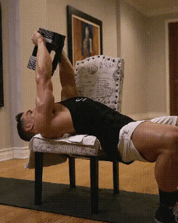

#### 功能调整 
胸椎段  伸展及旋转灵活度
肩胛骨下降后缩稳定性
肩关节外旋稳定性
前锯肌激活提供肩胛骨支撑稳定性

### 分化训练体系
将个体划分不同模块  周期循环训练
目的： 提高不同个体运动能力 及促进不同个体身体恢复水平
#### 一分化
1-3组 一个动作 适用于0基础体能较低，无训练计划，减脂人群居多。
#### 平板杠铃卧推：
2组热身 5组正式
#### 双分化
一次5个部位 /一个部位2-3个动作 /练3-4组
有训练或运动经验 体能水平中级 
一般动作以两个整体加一个局部为主
平板杠铃+上斜哑铃+坐姿蝴蝶机夹胸
#### 三分化 [三分化训练](17%20肩%20分化训练.md#三分化训练)
2-3个部位/3-4个动作/4-6组
三休一或6休1
胸+肩前束+三头（俩动作）
背+肩后束+二头
腿+臀
三分化体能水平要求较高，有训练经验，3休1适合增肌阶段，6休一适合减脂阶段，注意增肌阶段循环划分侧重点

胸4个动作   2个整体+2个局部

| 整体     | 局部    | 局部   | 整体    |
| ------ | ----- | ---- | ----- |
| 平板杠铃卧推 | 上斜史密斯 | 上斜哑铃 | 蝴蝶机夹胸 |
| 4组     | 6组    | 6组   | 4组    |
#### 四分化训练
体能水平较高，且有训练经历
一天2-3个部位/每个部位3-4个/4-6组
胸部训练 
女生 

| Day1 | Day2 | Day3       | Day4 |
| ---- | ---- | ---------- | ---- |
| 臀    | 背    | 胸 3个动作     | 腿后   |
| 腿    |      | 肩 3个动作     | 手臂   |
|      |      | 塑形一个整体俩局部  |      |
|      |      | 减脂2个整体一个局部 |      |
男生 如果减脂可以2练 遵循2个整体2个局部原则

|  Day1  | Day2 | Day3 | Day4 |
| :----: | :--: | :--: | :--: |
|   肩    |  背   |  胸   |  腿   |
| 腿后（2练） |  二头  |  三头  |      |
|        |      |      |      |
#### 5分化
第一种情况： 完全无训练经历且体能水平极低，或大基数人群，每次训练1-2个部位 、2-3个动作、4-6组 结合功能性体能训练
##### 训练思路
胸
背
肩
休息
腿
手臂
第二种情况：训练水平极高 单次训练肌肉代谢压力较大，每个部位4-5个动作、4-6组，局部动作强度可以调低一些。
#### 整体维度方向
##### 调整胸宽度
平板杠铃卧推 ，强度 3-20rm
史密斯卧推 强度：8-20rm
坐姿推胸器，强度5-20rm

平板哑铃飞鸟，强度 10-20rm 调整厚度偏外侧
##### 厚度偏内
十字绳索夹胸，强度12-20rm
平板哑铃卧推 ，强度6-20rm
蝴蝶机夹胸 12-20rm
### 中上胸 
#### 上胸厚度，以宽为主
##### 上斜杠铃推胸 5-20rm
##### 上斜史密斯 8-20rm
### 调整上胸厚度偏内侧
##### 上斜哑铃卧推
∠30° 中上胸 强度：6-20rm
∠45° 中上胸厚度 强度：6-20rm
∠75° 胸肩厚度  强度： 10-20rm
##### 坐姿上斜推胸器
强度 5-20rm
##### 上斜塔式推胸器
强度： 8-20rm
##### 仰卧哑铃直臂提拉：

强度 12-20rm

##### 龙门架绳索夹胸
① 上斜低位 12-20rm
②上斜仰卧低位 10-20rm

### 中下胸
#### 中下胸厚度，调整外侧形态
##### 下斜杠铃卧推
强度 8-20rm
##### 下斜史密斯卧推
强度 10-20rm
##### 宽距双杠臂屈伸 
强度 10-20rm
#### 中下胸厚度偏内侧
##### 龙门架高危绳索夹胸
强度 12-20rm
##### 下斜哑铃卧推
强度 10-20rm
##### 坐姿下斜推胸器
强度： 8-20 高血压禁用
