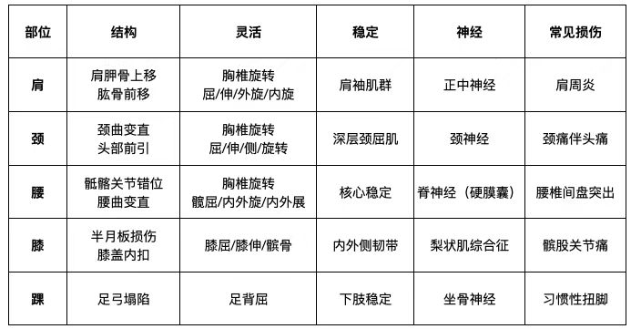

##### 膝关节评估 **半月板损伤**  
①单腿站立 膝关节旋转 应无疼痛 
②按压膝关节缝应无疼痛
③小腿外旋 膝盖向内画圈 应无疼痛 小腿内旋 膝盖向外画圈 应无疼痛
建议
①被动小腿内外旋 半月板复位
② 松解腘肌 半腱肌
③ 训练股内侧头 膝伸末端15°  仰卧泡沫轴
站姿双腿 单腿 负重 15°屈
##### 结构膝盖内扣 
站姿位 髂前上棘 、髌骨1/2与 第二脚趾在一条直线上
**建议** 松解拉伸内收肌  训练胫骨内旋 股骨外旋
**动作** 
①俯卧胫骨内旋腿弯举
② 仰卧脚内八臀桥 
③站姿深蹲股骨外旋
##### 膝关节稳定 **内外侧韧带**
仰卧直膝 向内向外推动膝关节 活动度应为0
建议 ①激活臀中小肌 
②训练臀中小肌(动作1 侧支撑蚌式 2 站姿髋外旋 仙女蹲 3横跳 骨盆稳定)
③减少重复性运动
##### 膝关节评估  **梨状肌综合征** 
(久坐)打麻将 开车 程序员 美术生 可能肌肉注射  急性处理较弱  
骶骨马尾神经 孕期骶骨和上臀痛
**评估**：仰卧被动髋内收加内旋到末端 ，臀应无疼痛
**建议**  
①放松骶骨孔、梨状肌  
②牵拉髋 、踝神经各30次
③减少久坐
##### 膝关节常见损伤 **髌骨关节痛**  
(下楼梯痛 膝前痛 下坡痛 髌骨压力大)髌骨软化 向外侧倾斜或半脱位
**评估** 仰卧轻压髌骨上方 主动收缩股四头肌应无疼痛。
**建议** ①髌骨松动  侧卧轻推髌骨
②松解 股四头肌 髂胫束
③ 训练臀中小肌
④减少下肢运动

