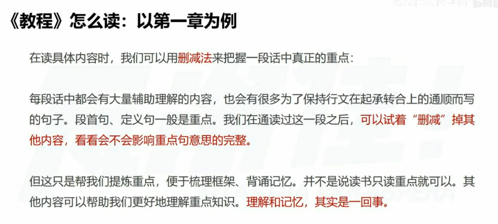
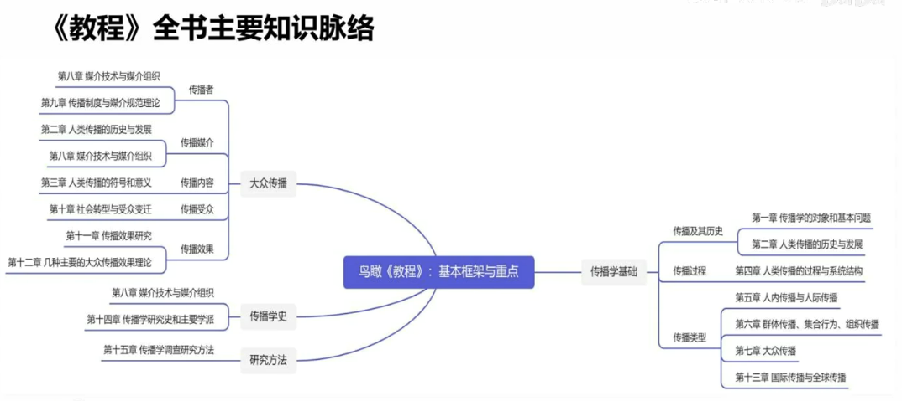
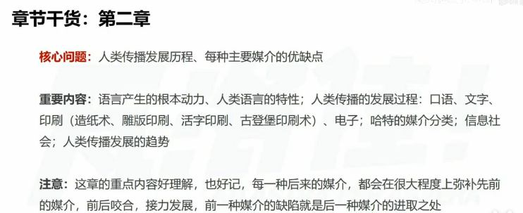
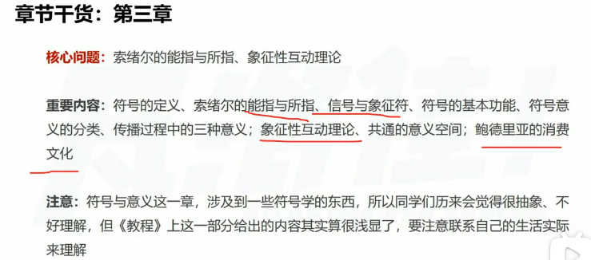
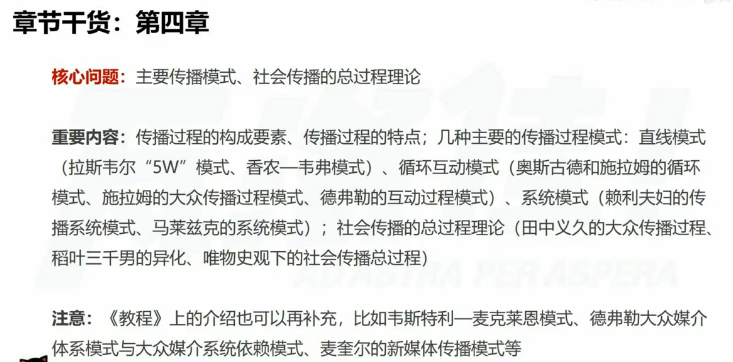

1.思考作者为什么这样写、这样安排结构，把握住重点在哪里
2.在摸清原有框架的基础上，破而后立，抽出对自己而言最重要的点，重新编排，形成自己的知识框架。
##### 第一章知识框架
> （原笔记含 Excalidraw 图，站点未收录）

红色重点
绿色带过

第二，**社会传播是在一定社会关系中进行的，又是一定社会关系的体现。**施拉姆说“传播一词和社区(community)一词有共同的词根，这并非偶然。没有传播，就不会有社区;没有社区，也不会有传播。”①所谓社区也就是由地缘关系和社会关系构成的共同体。传播产生于一定的社会关系，这种关系可能是纵向的，也可能是横向的;它又是社会关系的体现，传受双方表述的内容和采取的姿态、措辞等，无不反映着各自的社会角色和地位。社会关系是人类传播的一个本质属性，通过传播，人们保持、改变既有的社会关系并建立新的社会关系。

大众传播 5w理论
第八章 技术类 麦克卢汉
实物论

#### 第二章
#### 第三章

罗兰 巴特 
#### 第四章

第一章解决了传播的定义
第二章讲解了传播历史发展问题
第三章 传播内容问题
第四章 传播过程 传播模式
